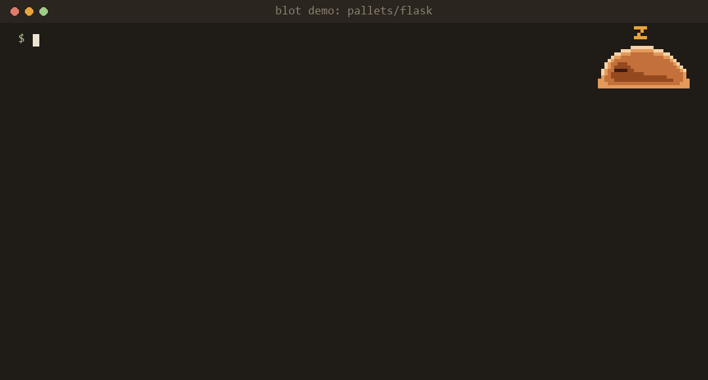

# Blot

[](https://github.com/Sym-jay/Blot/actions/workflows/ci.yml) [](https://pypi.org/project/blot-git/)


**A pre-commit check that has read your project's history.**

Meet **Sora**, the slime who remembers every fix.

> Don't take down a fence until you know why it was put up.

Blot warns you *before you commit* when your change:

- **removes a fix**: deletes or edits code that was added to fix a bug
- **re-adds a bug**: brings back a line that a bug fix deliberately removed
- **forgets a related file**: changes `A` but not `B`, when the two almost always change together

It runs locally, needs no account or AI, and stays quiet unless the history gives it a real reason to speak.



*A real run on Flask. Plain `git blame` points to a 2023 commit that only moved this line; Blot traces past it to the 2020 fix that explains it. (Regenerate with `python assets/demo/make_demo.py`.)*

> **Status:** pre-alpha. Milestones M1 and M2 are done: `blot index` builds the history index (Flask's 3,800 commits in ~2 s), `blot install-hook` wires up git, and `blot check` runs the three checks. On Flask it traces an edit to `self_ref = weakref.ref(self)` past the 2023 file split to the 2020 fix, in under 500 ms. Replayed on the last 500 commits of Flask, requests, Express, Django and React, it warns on 0.6–10% of commits; see [bench/RESULTS.md](bench/RESULTS.md). Roadmap: [PRD](docs/PRD.md#12-milestones-4-weeks-part-time).

## Meet Sora


Sora is Blot's slime. You'll see a different face depending on what Blot finds:

| | Face | When |
|---|---|---|
|  | Idle | Checking your commit |
|  | Happy | Nothing to worry about |
|  | Alert | Found a fence: this line fixed a bug |
|  | Worried | Risky change, take a look |
|  | Sleepy | Indexing history |
|  | Sad | A fix is being removed |

Sora comes in four warm palettes:

 
 

## Quickstart

```bash
pip install blot-git  # the PyPI name is blot-git; the command is just `blot`
cd your-repo
blot index            # optional: the first check builds .git/blot.db itself and keeps it current
blot install-hook     # adds Blot to .git/hooks/pre-commit without touching existing hooks
```

For the latest unreleased code, use `pip install git+https://github.com/Sym-jay/Blot` instead.

Remove it any time with `blot install-hook --uninstall`. Settings go in `[tool.blot]` in `pyproject.toml` or a `.blot.toml` file (see `src/blot/config.py`).

Or with the [pre-commit](https://pre-commit.com) framework, see `.pre-commit-hooks.yaml`.

## Ask why a line exists

```
$ blot why src/flask/app.py:355
src/flask/app.py:355
  | self_ref = weakref.ref(self)
  explained by  8efea0cc  2020-10-03  Break reference cycle created by default in Flask instances.  [bug fix]
  traced past   0ec7f713  2023-06-11  Split the App and Blueprint into Sansio and IO parts  [refactor]
```

`blot why FILE:LINE` (or `FILE:START-END`) finds the commit that explains a line, skipping commits that only moved it. Plain `git blame` stops at the refactor.

## Issue and PR titles (optional)

```bash
blot index --github
```

With the [GitHub CLI](https://cli.github.com) logged in, Blot fetches the titles and labels of the issues and PRs your fix commits mention, so warnings read `fixes #2935 "copy_current_request_context copies old session object"` (a real Flask issue) instead of a bare number. A `bug` label makes a commit count as a load-bearing fix; a fix-looking commit whose issues are only labelled `enhancement` or `documentation` is demoted. Refreshes only fetch what's new. Repos with GitHub Issues turned off (they track bugs elsewhere) are skipped.

## Use in CI

Run Blot on every pull request and see its findings as warnings on the changed lines:

```yaml
# .github/workflows/blot.yml
name: Blot
on: pull_request
jobs:
  blot:
    runs-on: ubuntu-latest
    steps:
      - uses: Sym-jay/Blot@v0.4.0
```

The action checks out the pull request with its full history, installs Blot, runs `blot index` and
`blot check --range origin/<base>..HEAD --format json`, and turns each finding into a warning annotation.
It never fails the job because of findings. Inputs: `blot-package` (what to `pip install`; default
`blot-git`, the latest PyPI release), `python-version` (default `3.13`) and `base-ref`
(default: the pull request's base branch).

## Measure it on your repo

```bash
blot bench --replay 500
```

Re-checks your last 500 commits as if each were being committed, and lists every warning Blot would have shown. See [bench/README.md](bench/README.md).

## Docs

- [What is this? (simple explanation)](docs/EXPLAINER.md)
- [Product requirements](docs/PRD.md)
- [Competitor tests](docs/competitors.md)
- [Contributing](CONTRIBUTING.md)

## License

MIT

Sora's body shape is based on [Animated Pixel Slime](https://rvros.itch.io/pixel-art-animated-slime) by rvros (CC0), recolored and given new expressions. Regenerate the sprites with `python assets/sora/build_sprites.py`.
