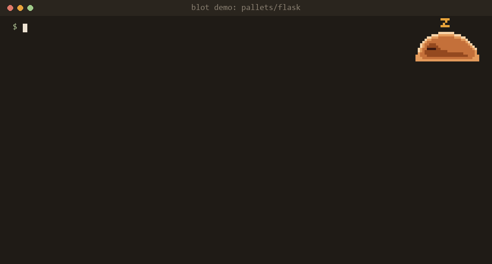

# Blot

**A pre-commit check that has read your project's history.**

Blot warns you *before you commit* when your change:

- **removes a fix**: deletes or edits code that was added to fix a bug
- **re-adds a bug**: brings back a line that a bug fix deliberately removed
- **forgets a related file**: changes `A` but not `B`, when the two almost always change together

It runs locally, needs no account or AI, and stays quiet unless the history gives it a real reason to speak.



```bash
pip install blot-git
cd your-repo
blot index           # optional: the first check indexes history itself
blot install-hook    # adds Blot to your pre-commit hook
blot why src/app.py:42   # which commit explains this line, skipping refactors
blot map src/app.py      # which lines of the file exist because of bug fixes
blot index --github  # optional: issue/PR titles and labels via the gh CLI
```

**Guard coding agents.** `blot install-agent-hook` adds a Claude Code hook that runs the same checks on
an edit an agent is about to make, so the agent sees "this line exists because of fix 8efea0c" before
it "simplifies" it away. It warns by default; `--ask` makes Claude Code ask you first.

**Tell agents before they plan.** `blot mcp` is a stdio MCP server (standard library only) with two
read-only tools, `load_bearing_lines` (like `blot map`) and `explain_lines` (like `blot why`), so an agent
can look at a file's fixes before deciding what to change. `blot install-mcp` registers it in `.mcp.json`
for Claude Code; `--local` registers it just for you.

> **Status:** pre-alpha. All three checks work. Replayed on 500 recent commits each of Flask, requests, Express, Django and React, Blot warns on 0.6–9.5% of commits, and about half of its warnings (labelled by hand) are worth a reviewer's time; see the bench results on GitHub. Please report false alarms.

Meet Sora the slime, read the docs, or contribute on GitHub: https://github.com/Sym-jay/Blot
